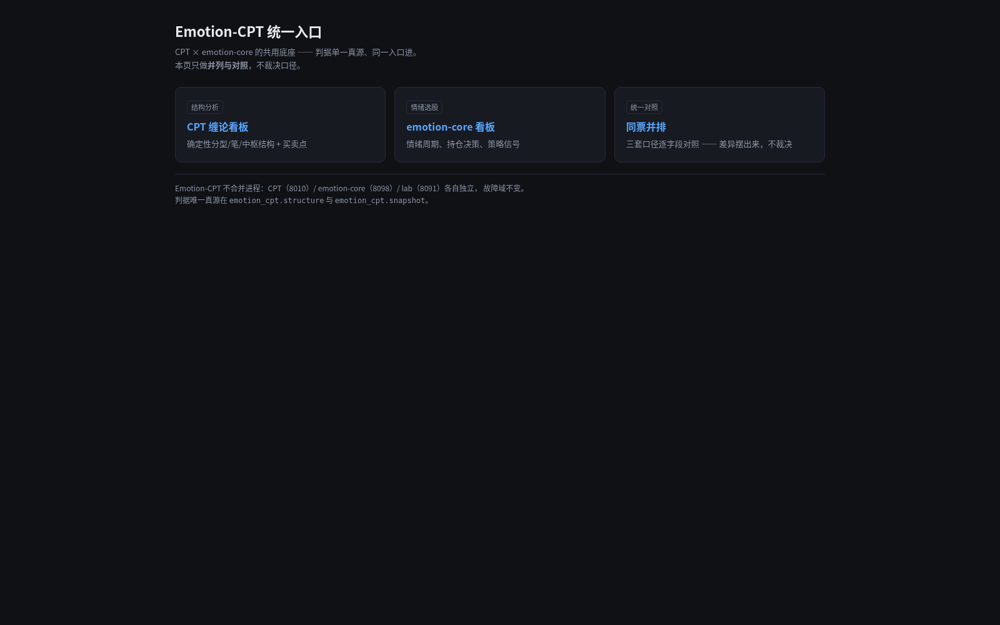
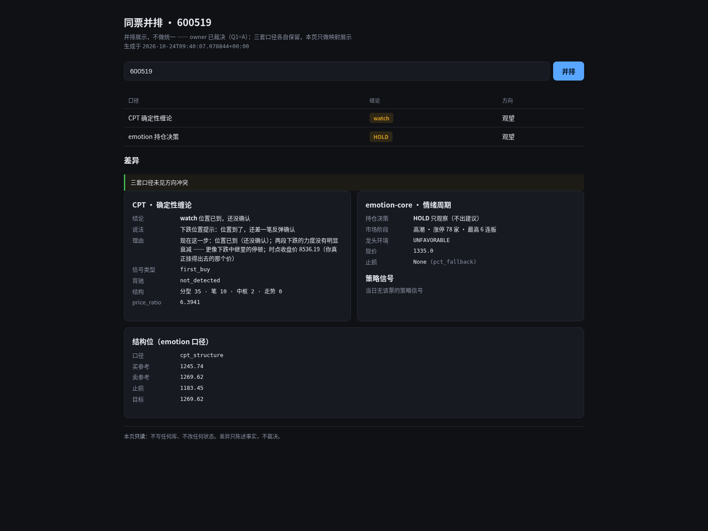
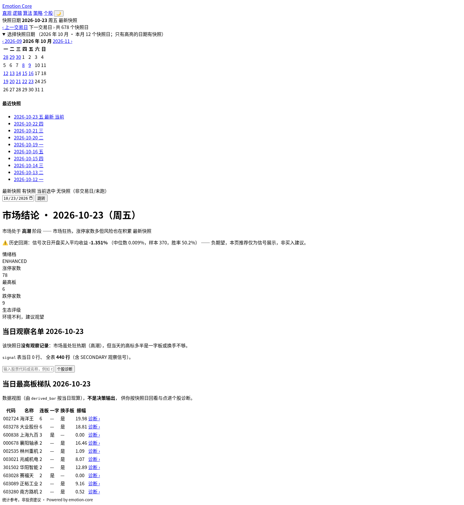
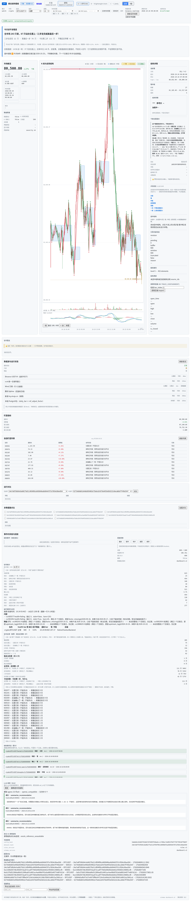

# 三个项目实地对比（浏览器渲染）

> 2026-10-24 · 用 Chromium 经 SSH 隧道**直连真机**渲染（不是截图模拟、不是 mock）。
> 页面体量数据用 `document.body.scrollHeight` / `querySelectorAll('*')` **实测**。
>
> 渲染方式：沙箱 Playwright + Chromium ⇒ SSH 隧道 ⇒ Oracle 的 `127.0.0.1:8092/8098/8010`
> ⇒ **绕开 nginx 的 basic auth**（页面是真的，只是没走 auth）。
> CPT 的页面是 nginx 发的**静态 SPA**（`/var/www/cpt-dashboard/`），
> 页面里写死 `/cpt/api/dashboard/track` ⇒ 沙箱起了个代理把 `/cpt/api/*` 转到真机 8010
> ⇒ **带真实数据**，不是空壳。

---

## 1. 一句话结论

**三个项目不是同一类东西，也不该长得一样。**

- **CPT** = 单标的**深度终端**（缠论结构）—— 最重、最专业
- **emotion-core** = **市场/情绪总览**（日频）—— 中等，但**界面最糙**
- **Emotion-CPT** = **入口 + 对照层** —— 最轻，**不重复任何业务看板**

⇒ Emotion-CPT 的价值**不在于它自己的界面**，而在于
**它是唯一能让另外两个「并排可比」的地方**。

---

## 2. 实测体量

| 页面 | 宽 × 高 | 屏数（按 900px） | DOM 元素数 |
|---|---|---|---|
| **Emotion-CPT 门户** | 1600 × **395** | **0.4 屏** | **32** |
| **Emotion-CPT 同票并排** | 1600 × 1059 | 1.2 屏 | 84 |
| **emotion-core 看板** | 1600 × 1726 | 1.9 屏 | 331 |
| **CPT 看板** | 1600 × **7603** | **8.4 屏** | **2745** |

⇒ Emotion-CPT 门户只有 **32 个 DOM 元素**；CPT 看板有 **2745 个**（差 85 倍）。

---

## 3. 逐个看

### 3.1 Emotion-CPT 门户（`/dsh/`）



- 一屏讲完：**三个入口卡片**（CPT 缠论看板 / emotion-core 看板 / 同票并排）
- 底部明写边界：
  > Emotion-CPT 不合并进程：CPT (8010) / emotion-core (8098) / lab (8091) 各自独立，故障域不变。
  > 判据唯一真源在 `emotion_cpt.structure` 与 `emotion_cpt.snapshot`。
- **零数据请求** ⇒ 打开即用，上游挂了也照开（见 §5）

### 3.2 Emotion-CPT 同票并排（`/dsh/aggregate/stock/600519`）



- 上半：一行**结论对照表**（口径 / 结论 / 方向）
- 下半：**两栏逐字段明细**（CPT 侧 7 个字段、emotion-core 侧 6 个字段）+ 结构位区块
- 差异区显式写「三套口径未见方向冲突」
- 底部：**「本页只读：不写任何库、不改任何状态。差异只陈述事实，不裁决。」**
- 页头：**「并排展示，不做统一 —— owner 已裁决（Q1=A）：三套口径各自保留，本页只做映射展示」**

> ⚠️ **看图时注意到的一件事**（不是 bug，是**数据缺失**）：
> 表里只有 **2 行**（CPT 确定性缠论、emotion 持仓决策），
> 第三套「情绪策略」当天**没有数据** ——
> emotion-core 的 `/api/strategy` 返回 `{"items": [], "note": "当日无策略产出（开关未开或休市）"}`。
> 页面诚实地写了「当日无该票的策略信号」✅
> 但页头写「三套口径」而表里 2 行 ⇒ **读的人会以为少了口径**。
> ⇒ 建议：把页头改成「**三套口径各自保留（本页展示 2 套有数据的）**」。

### 3.3 emotion-core 看板（`:8098`）



- **裸 HTML，无 CSS** ⇒ 工程感强、但**视觉上最糙**
- 内容：快照日期 + 日历 + 市场结论（高潮阶段 / 涨停 78 / 跌停 9 / 生态评级 环境不利，建议观望）
  + 当日观察名单（无记录）+ 当日最高板梯队（表格）
- 免责声明齐全（「负期望，本页推荐仅为信号展示，非买入建议」「统计参考，非投资建议」）
- 快照日是 **2026-10-23**（日频，比今天晚一天）

### 3.4 CPT 看板（`:8010` 的静态 SPA）



- **8.4 屏**的专业交易终端：K 线主图 + 指标 + 成交量 + 右侧盘口/成交明细/信号日志
  + 结构分析 / 笔 / 中枢 / 买卖点 / 实时结构 / 信号推送 / 逐笔明细 / debug / SQL 日志
- 唯一**实时轮询**的（页面自带「跳转到 8088…」等操作）
- 数据源：自有 DB + 实时行情

---

## 4. 横向对比

| 维度 | Emotion-CPT | emotion-core | CPT |
|---|---|---|---|
| **形态** | 门户 + 同票并排 | 市场/情绪总览 | 单标的深度终端 |
| **视觉** | 深色卡片，整洁 | **裸 HTML，无 CSS** | 完整终端 UI |
| **体量** | 0.4 / 1.2 屏 | 1.9 屏 | **8.4 屏** |
| **数据来源** | **不存**，只 HTTP 读上游 | 自有 DB（日频快照） | 自有 DB + 实时轮询 |
| **依赖数据库** | **否** | 是 | 是 |
| **写入行为** | **全只读** | 日更 + 盘中采集 | 日更 + 实时轮询 |
| **失败域** | 上游挂了照常开 | 挂了就没了 | 挂了就没了 |
| **时间口径** | 实时（每次访问现读） | T-1 快照 | 实时 |

⇒ **Emotion-CPT 是三者里唯一「不持有数据、不写数据、不依赖 DB」的**。

---

## 5. 隔离的运行时证据（`/api/health`）

```json
{
  "ok": true,
  "self": "emotion-cpt-facade",
  "cpt":         {"base": "127.0.0.1:8010", "ok": true, "error": null},
  "emotion_core": {"base": "127.0.0.1:8098", "ok": true, "error": null, "phase": "高潮"},
  "lab":         {"base": "127.0.0.1:8091", "ok": true, "error": null}
}
```

⇒ 逐个报可达性 + 原因。**上游全挂时这里仍是 200**（见 `tests/test_facade_isolation.py`）。

---

## 6. 看完之后的结论

1. **三个页面的定位没有重叠** —— Emotion-CPT 不用去「做得更像看板」，
   它的活是**入口 + 并排对照**，做得越轻越对。
2. **界面最糙的是 emotion-core** —— 裸 HTML 无 CSS。
   这不是 Emotion-CPT 该管的事（前端不搬），但**值得记一笔**。
3. **CPT 看板 8.4 屏** —— 功能最全，但也最重；
   同票并排把「跨项目的结论」抽出来，是它自己做不到、也不该做的那部分。
4. **一处可改的措辞**：聚合页页头「三套口径」在只显示 2 行时容易被误读（见 §3.2）。
